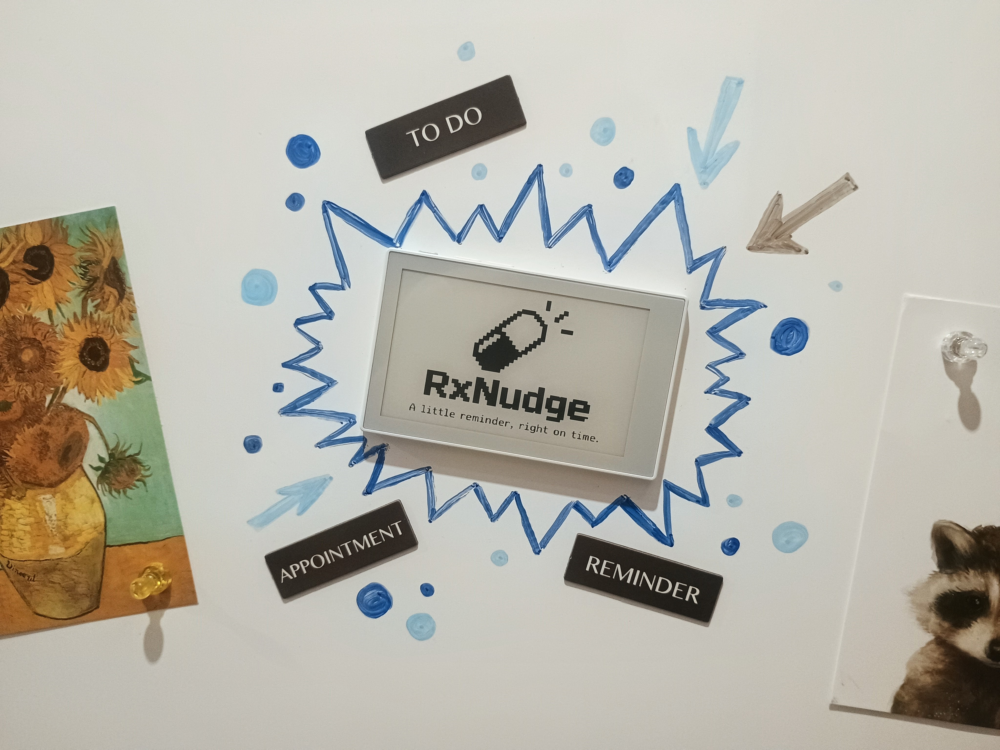

# RxNudge




Medication reminder firmware for the **Seeed reTerminal Sticky** (ESP32-S3, 3.97" 800 x 480 e-paper, touch,
buzzer, battery, microSD, RTC). Several people per household, each with their own medicines, schedules,
reminders, PIN and history.

> **Not a medical device.** RxNudge is a reminder aid. See the disclaimer in [docs/USER_GUIDE.md](docs/USER_GUIDE.md).

## Features
- Schedules: fixed times, weekdays, every N days/weeks, specific dates, on/off cycles, multi-phase (tapers),
  as-needed with a 24 h maximum. Time zones and DST.
- Alarm ladder with snooze (5/10/15 min, max 3), grace period, Missed state, quiet hours with an "Important"
  override, per-person and per-medicine tone and volume, visual-only fallback.
- No double dosing: taken doses cannot be retaken, backfills near the next dose are refused, no catch-up doses.
- Power-loss safe storage (CRC records, tmp/bak rotation, append-only dose log), deep sleep with catch-up.
- On-device management (medicines, people, settings, setup wizard, PIN lock, US QWERTY keyboard).
- Optional Wi-Fi: NTP time sync, LAN web portal, OTA with rollback, ntfy/webhook missed-dose alerts.
  Works fully offline; radio off by default.
- CSV/JSON export, SD backup/restore, nightly automatic SD backups (14 kept), schema migrations.

## Quick start
```bash
pip install --user platformio
pio test -e native          # host tests (no hardware)
pio run -e sticky           # firmware
./scripts/flash_sticky.sh /dev/sticky full   # first install over USB
./scripts/make_release.sh   # clean build + tests + previews + release archives
```
Prebuilt: `rxnudge-v1.0.4-binaries/` (merged flash image, parts, SHA-256).

## Documentation
| Doc | For |
|---|---|
| [docs/USER_GUIDE.md](docs/USER_GUIDE.md) | household users |
| [docs/BUILD_FLASH.md](docs/BUILD_FLASH.md) | building, flashing, self-test, release binaries |
| [docs/ARCHITECTURE.md](docs/ARCHITECTURE.md) | code structure, tasks, storage, net |
| [docs/HARDWARE_NOTES.md](docs/HARDWARE_NOTES.md) | board facts, sources, open hardware assumptions |
| [docs/POWER.md](docs/POWER.md) | sleep, wake, battery policy and estimate |
| [docs/OTA.md](docs/OTA.md) | firmware updates and rollback |
| [docs/RELEASE_CHECKLIST.md](docs/RELEASE_CHECKLIST.md) | definition of done, host vs device verification |
| [docs/KNOWN_LIMITATIONS.md](docs/KNOWN_LIMITATIONS.md) | limits and measured numbers |
| `docs/screens/`, `docs/portal/` | rendered UI previews | rendered before final name MedTracker/RxNudge |

## Status
Host-verified: clean builds, all native tests, rendered previews.
**Device-verified (1.0.4):** flashed and tested on reTerminal Sticky production hardware — power-on, setup wizard, home screen, alarms, touch/buttons, sleep/wake, and optional Wi-Fi/portal all passed.

## Licences

Board drivers in `lib/` are from LowFlowIO/sticky-micronotes (MIT, `lib/LICENSE-sticky-micronotes`). Atkinson Hyperlegible font: SIL OFL 1.1.
esp_littlefs: MIT.

## AI Declaration 

Multiple models used for working phase drafts, documentation and code cleaning/normalization.
